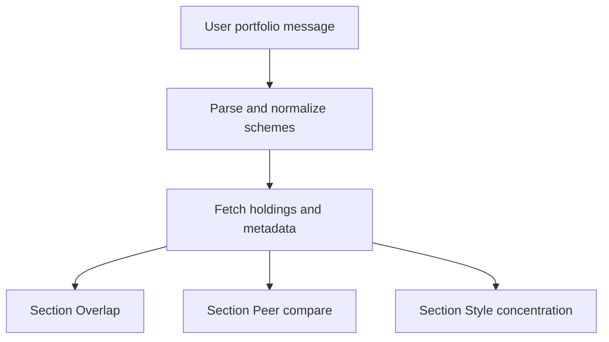
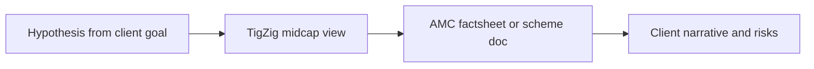

# MFRoboAdvisor

Unified plan: **TigZig-inspired MF analytics**, **chat intake + structured research thread**, and **five tracked todos** below.

## What you are working with

- The page you linked ([TigZig midcap analysis dashboard](https://www.tigzig.com/midcap-analysis-dashboard)) is part of TigZig’s “AI for Analytics” app catalog; the live UI is largely rendered in the browser, so third-party crawls often show only the shell.
- TigZig’s main site positions **MFPRO** as mutual fund portfolio analytics: holdings analysis, fund returns, index benchmarks, and composition across a fixed set of funds/categories ([TigZig home / apps](https://www.tigzig.com/)).
- Separately, TigZig’s author has described a **midcap mutual fund analysis dashboard** as an interactive, filter/sort/drilldown view of **top midcap fund holdings**, distributed as a **single-file** client-side app (useful for offline or low-IT environments) — see [Medium: single-file React dashboard](https://medium.com/@amarharolikar/bundle-your-ai-app-or-react-dashboard-into-a-single-file-no-server-required-n-867944f19adf).

Treat the midcap URL as a **category-focused holdings lens**, and MFPRO (if you use it from the same ecosystem) as a **broader MF analytics** surface; combine them rather than expecting one URL to do everything.

## Primary data source: MFPRO

**Decision:** Mutual fund analytics for MFRoboAdvisor connects to **MFPRO** as the primary data stack for India-focused funds:

- Entry / product link: [tigzig.com/mfpro](https://www.tigzig.com/mfpro)
- Live analytics app: [mfpro.tigzig.com](https://mfpro.tigzig.com/)
- NAV downloads & REST API (same ecosystem, built as part of MFPRO): [mfpro.tigzig.com/data-api](https://mfpro.tigzig.com/data-api)

TigZig’s own AI-readable posts describe **two layers**: a rich **MFPRO app** (returns, indices, curated holdings comparisons, disclosure-based composition) and a **broad NAV API / file exports** (millions of NAV rows across tens of thousands of schemes). See [MFPRO v2 — rolling returns & holdings](https://www.tigzig.com/ai/posts/mfpro-v2-mutual-fund-analytics-rolling-returns.md) and [India MF NAV data API](https://www.tigzig.com/ai/posts/mfpro-india-mutual-fund-nav-data-api.md).

**Live MFPRO product (UI, Apr 2026):** The in-app **Compare Funds and Indices** flow states coverage of **CAGR, rolling returns, risk metrics, and drawdown across 13,000+ mutual fund schemes and indices**, with tabs for **Returns**, **Composition**, **SIP**, **TER**, **Category**, **Fund**, plus **Data & API**, validation, and download controls. Treat **13,000+** as the current marketing/product scope for **return and risk analytics**; older blog line counts (e.g. **95** funds on v2 return screens, **17,866** NAV API schemes) are **secondary**—reconcile at integration time via **Data & API** / Swagger and the **Status** page. Reference capture: [/Users/vedantupadhyay/.cursor/projects/Users-vedantupadhyay-Documents-mf-advisor-workbench/assets/Screenshot_2026-04-16_at_11.05.58_AM-133de96b-7ce4-416c-831b-8d0cfd37a2db.png](/Users/vedantupadhyay/.cursor/projects/Users-vedantupadhyay-Documents-mf-advisor-workbench/assets/Screenshot_2026-04-16_at_11.05.58_AM-133de96b-7ce4-416c-831b-8d0cfd37a2db.png).

### Can we get all relevant data for this plan from MFPRO?

**Short answer:** still **no** for a fully unconstrained portfolio if you need **security-level overlap** and **holdings-based style** for every scheme—but **yes** for a **much wider** set of schemes on the **returns / risk / drawdown / peer-return** pillar than older TigZig posts implied (**13,000+** per live MFPRO UI). MFPRO’s **Composition** path may still be **narrower** than that return headline; confirm per scheme before promising overlap and concentration from MFPRO only.

| Data needed for MFRoboAdvisor | From MFPRO alone? | Notes |
| --- | --- | --- |
| Point-to-point and rolling **returns**, **risk metrics**, **drawdown**, multi-fund vs index compare | **Yes for a large universe (per live UI)** | Live UI: **13,000+ schemes and indices**. Older v2 post cited **95 funds & 9 indices** for some views; NAV API post cited **17,866** schemes for NAV history—use **Data & API** as ground truth for automation. |
| Peer compare focused on **return, risk, drawdown, rolling distribution** | **Mostly yes** | Align peer lists with schemes inside the **13,000+** scope; use UI **Category** / **Fund** filters and benchmark selector (e.g. Nifty 50) for comparability. |
| Security-level **overlap** across the user’s actual list of funds | **Uncertain / often no** | Requires **Composition** (holdings) coverage per scheme—not proven equal to **13,000+** from this screenshot alone. v2 post documented **24 funds across 6 categories** for multi-period **holdings** comparison; treat **holdings breadth** as **verify in app + API**, not assumed from return headline. |
| **Style / concentration** (sectors, themes, top-10) from holdings | **Uncertain / often no** | Same as overlap: depends on **Composition** depth. If a scheme lacks line-item data in MFPRO, add **supplemental holdings** (e.g. monthly disclosure pipeline). |
| Holdings vs **Nifty** benchmarks | **Yes when MFPRO exposes composition for that scheme** | v2: fund vs index and index constituents; confirm scheme-level availability in current **Composition** UX. |
| **TER** and **category**-style labels | **Partially (UI suggests it)** | Sub-tabs **TER** and **Category** in the live UI—good for peer compare copy; still **cross-check** material facts on AMC factsheet where compliance requires. |
| **Pre-computed rolling returns** via bulk/API | **Partially** | NAV API post still mentions **104** funds with pre-computed rollings for that surface—may not match full **13,000+** app logic; unify when wiring **Data & API**. |
| Full **regulatory factsheet** fields | **Do not assume complete** | Keep **AMC factsheet / SID** path. |
| User’s **portfolio weights** (₹ or % per scheme) | **No** | **Chat intake** only. |
| **As-of** dates and data freshness | **Yes** | Use **Status** in MFPRO; NAV API: **3× daily** AMFI sync (per NAV post); data-api **beta** flag. |

**Implementation note:** Confirm allowed use (automation, caching, commercial use) from TigZig’s terms and the live **Swagger** for the exact JSON fields you will parse. Respect **rate limits** (e.g. **100 req/min per IP** on the NAV API per the NAV post).

## Product concept: chat as the intake, structured thread as the output

This extends the manual workflow into something you could build in **mf-advisor-workbench** (or any advisor product): the user describes current MF investments in natural language (or a short structured paste), and the assistant responds as **one client research thread** with three predictable blocks—mirroring how a human advisor would use TigZig-style dashboards without letting the chat wander.

### Intake (what the user gives)

- **Identifiers**: Scheme names, ISIN, or AMFI codes; fuzzy match with confirmation for ambiguous names.
- **Sizing**: Current value, allocation percentage, or SIP plus optional lump sum—enough to weight overlap by economic exposure, not just “same stock appears twice.”
- **Context (optional but useful)**: Goal, horizon, risk tolerance, and whether they want **India equity only** or multi-asset—so “peer compare” picks sensible peers.

### Output (always the same three sections)

1. **Overlap** — Combined top holdings across their funds; names appearing in multiple schemes; estimated double-count by weight; concentration in top 5 / top 10 if data allows.
2. **Peer compare** — For each major category they hold (e.g., midcap active vs index), 2–4 **peer funds** with comparable mandate; compare expense, portfolio turnover proxy if available, recent risk/return **labels** (not hype), and “why this peer set was chosen.”
3. **Style / concentration** — Category mix (large/mid/small, debt vs equity), sector/theme tilts implied by holdings, style box language (growth/value/blend) **as inference from data** with uncertainty called out.

Each thread should end with **assumptions and limits**: data as-of date, what was inferred vs verified, and a line that numbers are **not** a recommendation to buy/sell.

### Flow (high level)

### Build-time decisions (when you move from plan to implementation)

- **Data**: MFPRO for **returns / risk / drawdown** at **13,000+** scheme scale (per live UI); **Composition** / overlap per scheme only after **verifying** coverage in app or API—**supplement** with regulatory monthly disclosure or factsheet feeds where holdings are missing; stale data is worse than “I can’t compute overlap.”
- **Peers**: Rule-based (same AMFI category + similar benchmark) plus human-overridable list for advisors.
- **Compliance**: Jurisdiction-specific copy; log inputs/outputs if your license requires auditability.

## How to “best use” it (advisor workflow)

### 1. Start with a clear question

Pick one intent per session so the dashboard does not become noise:

- **Overlap / concentration**: “Do these midcap funds all crowd into the same names?”
- **Style drift**: “Does this fund’s visible basket look like midcap growth vs value vs blend?”
- **Compare peers**: “Among 2–4 shortlisted midcap funds, which is more diversified in the top 10?”

### 2. Use filters and sorts deliberately

For holdings-style dashboards (as described for the midcap app), a disciplined pattern works well:

- **Sort** by weight or rank within a fund to see true conviction names.
- **Filter** to sectors or market-cap bands if exposed in the UI, to check unintended bets (e.g., financials or a single theme dominating).
- **Drill down** only after you have a hypothesis from the aggregate view, so you do not chase idiosyncratic small weights.

### 3. Pair dashboard views with your own checks

No external dashboard replaces regulatory factsheets or AMC disclosures. A strong workflow is:

Use TigZig to **generate questions**; use official documents and your compliance process to **confirm** and to phrase advice.

### 4. Document snapshot and limitations

If you cite screenshots or specific weights in notes or reports:

- Record **as-of date** shown in the app (or export if available).
- Note that **single-file / browser apps** may update on redeploy; reproducibility for audits favors saving the **exact artifact** or a dated export rather than “I looked at the site.”

### 5. When to prefer MFPRO vs midcap dashboard

- Use the **midcap dashboard** when the conversation is **category- and holdings-specific** among midcap peers.
- Use **MFPRO** (from [TigZig](https://www.tigzig.com/)) when you need **returns, benchmark-relative framing, and composition** across the broader curated fund set described there.

## Out of scope for this answer

- This is **not** investment advice or a substitute for suitability analysis.
- **mf-advisor-workbench**: the chat + three-section thread is a concrete product direction you can implement locally; TigZig pages remain a **reference UX** unless you integrate their data or embed their apps under their terms.
